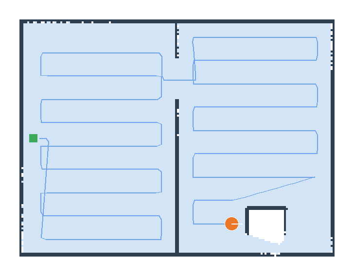

# Neato D7 for Home Assistant

Local control and lidar maps for Neato Botvac D3-D7 robots, now that Neato's
cloud is gone. An ESP32 inside the robot passes the serial debug port to Home
Assistant over Wi-Fi, and the **Neato Mapper** add-on does the rest.



*A map built by the add-on from a simulated two-room clean: walls from the
lidar, the cleaning path in blue, the dock in green and the robot in orange.*

## What works (stage 1)

- A floor map that builds up from the robot's lidar during every normal clean
  and is shown in Home Assistant as `camera.neato_map`
- A vacuum entity: start, pause, resume, stop, spot clean, return to base
- Battery, robot state and error sensors
- A "Reset map" button and a raw serial command for diagnostics

Coming next: rooms ("clean the kitchen") in stage 2, and no-go lines in stage 3.

## How it fits together

```
Neato D7 --serial--> ESP32 (ESPHome stream server) --Wi-Fi/TCP--> Neato Mapper add-on --MQTT--> Home Assistant
```

The ESP32 is only a pipe; it has too little memory for mapping. The add-on
asks the robot for its own SLAM position (`GetRobotPos Smooth`) and a lidar
scan (`GetLDSScan`) a couple of times a second while it cleans, and votes each
scan into an occupancy grid. Every clean refines the same map.

## Install

You need Home Assistant OS or Supervised (for add-ons), the Mosquitto broker
add-on and the MQTT integration.

1. **Flash the bridge.** In the ESPHome dashboard create a new device and paste
   [`esphome/neato-bridge.yaml`](esphome/neato-bridge.yaml). Set the pins for
   your board (same as fang: ESP32 TX 17 / RX 16, ESP32-C3 TX 7 / RX 6) and add
   `neato_bridge_api` and `neato_bridge_ota` to your ESPHome secrets. This
   replaces fang on the ESP; you can flash fang back at any time.
2. **Add this repository** in Settings > Add-ons > Add-on store > ⋮ >
   Repositories: `https://github.com/sascha3212/neato-d7-ha`
3. **Install Neato Mapper**, set *ESP32 bridge address* to the ESP's IP or
   hostname, and start it.
4. The robot appears under Settings > Devices > MQTT as "Neato".

## Show the map

The camera entity works in a picture card straight away. For a nicer view, and
for drawing rooms later, install the
[Xiaomi Vacuum Map Card](https://github.com/PiotrMachowski/lovelace-xiaomi-vacuum-map-card)
from HACS (it works with any vacuum) and use:

```yaml
type: custom:xiaomi-vacuum-map-card
entity: vacuum.neato
map_source:
  camera: camera.neato_map
calibration_source:
  camera: true
```

The add-on publishes `calibration_points` on the camera, in millimetres with
the dock at (0, 0).

## First run checks

These depend on your robot's firmware and could not be tested without one, so
please check them on the first clean:

1. **Position format.** Call `vacuum.send_command` with command `raw` and
   params `{"cmd": "GetRobotPos Smooth"}`. The "Last serial response" sensor's
   attributes show the answer. It should contain `X=`, `Y=`, `Theta=`, `Time=`.
   If the map stays empty, this is the first thing to look at.
2. **Walls line up.** After a clean, walls should be single crisp lines. If
   the map is mirrored, turn on *Lidar angles clockwise*. If walls are doubled
   or smeared, try *Lidar offset* (the turret sits behind the centre on most
   Botvacs, try -90 mm) or a small *Lidar angle offset*.
3. **Same map each time.** The robot starts every clean at the dock, so its
   coordinates should line up from one clean to the next. If a second clean
   draws a rotated copy, press "Reset map" and tell me what you see.

## Development

```bash
pip install -r neato_mapper/requirements.txt pytest
pytest -q tests
python -m tests.fake_robot --port 6638   # a simulated robot to point the add-on at
```

## Credits

- [fang](https://github.com/vacuula/fang) for the serial research and ESP32 wiring
- [OpenNeato](https://github.com/renjfk/OpenNeato) (MIT) for the serial
  protocol notes and the `SetEvent` key algorithm, ported to Python here
- [esphome-stream-server](https://github.com/oxan/esphome-stream-server)
